# Dokumen Desain: Rebuild Landing Page `amc.web.id` (AMC × Lusion Spatial Scroll)

> [!IMPORTANT]
> **Hard Gate (`superpowers:brainstorming`):** Belum ada satu baris pun kode produk yang ditulis atau diubah di repositori [amc](file:///home/antigravity/lexyth-kun/amc). Setelah dokumen desain ini kamu setujui, langkah berikutnya adalah menyusun *Implementation Plan* (`superpowers:writing-plans`), melakukan backup tag `landing-lama-v1`, membuat branch `redesign/landing-lusion-style`, lalu mengeksekusi 6 milestone secara bertahap dengan TDD.

- **Tanggal:** 25 November 2026
- **Repository Target:** `lexyth-kun/amc` ([/home/antigravity/lexyth-kun/amc](file:///home/antigravity/lexyth-kun/amc))
- **Branch Kerja & Pengaman Rollback:** branch `redesign/landing-lusion-style` | tag backup `landing-lama-v1` pada kondisi saat ini ([index.html](file:///home/antigravity/lexyth-kun/amc/index.html))
- **Hosting & Deploy Preview:** Cloudflare Pages (`npm run build` → `dist/`, tetap menjaga [_redirects](file:///home/antigravity/lexyth-kun/amc/_redirects) dan [order/index.html](file:///home/antigravity/lexyth-kun/amc/order/index.html))
- **Mode Anti-Slop:** `antislop active: during (session override)`
- **Model & Lingkungan Agent:** dijalankan di Google Antigravity dengan mode penalaran penuh (*high effort*), didokumentasikan secara transparan di `README.md` & `DECISIONS.md` sesuai Bagian 0.A.

---

## 1. Intent, Tujuan & Anti-Goals

### Intent & Mengapa (*The Why*)
Mengubah halaman depan `amc.web.id` menjadi pengalaman **spatial storytelling satu halaman panjang bergaya `lusion.co`**, namun dengan identitas **Putih & Sky Blue khas Al Muthi Creative (AMC)** dan katalog nyata toko digital (`https://order.amc.web.id`). Setiap pergantian dunia dikoreografi lewat **pin + scrub**, **pergantian warna latar yang tajam**, **garis motif biru yang tumbuh mengikuti scroll**, serta **scene WebGL 3D interaktif**, sehingga pengunjung merasakan sensasi berpindah halaman baik saat *scroll* maupun saat memilih menu.

### Design Read (`antislop` Part 3)
> Reading this as: **interactive digital-storefront landing page** for **Indonesian creators, students, gamers, and AI users**, in a **bright White & Sky Blue 3D-choreographed editorial language**, dial **ENERGY 3 / RHYTHM 3 / MOTION 3**.

### Goals
1. Mereplikasi struktur urutan section, bobot scroll sinematik (`Lenis lerp: 0.09` + `GSAP ScrollTrigger`), transisi warna tajam antar-dunia, dan kualitas interaksi `lusion.co` dalam palet terang AMC (90% putih/terang + 1 momen kontras gelap `#061A3A` pada sekuens sinematik `300vh`).
2. Memusatkan seluruh harga, stok promo, dan teks ke dua sumber kebenaran tunggal: `src/data/products.json` dan `src/data/content.json`.
3. Menjaga 100% integritas jalur menuju toko utama `https://order.amc.web.id` (termasuk redirect `/order` & `/order/*`, deep-link `#aplikasi/<slug>`, `#buzzer`, `#game`, WhatsApp Admin `+62 851-1712-0101`, dan WhatsApp Bot `+27 74 830 4118`).
4. Mencapai target kualitas wajib: Lighthouse Mobile Performance ≥ 85, LCP < 2.5 dtk, CLS < 0.1, JS awal < 300 KB gzip (*lazy-load* Three.js setelah preloader), kontras teks WCAG AA ≥ 4.5:1, aksesibilitas keyboard penuh, dan dukungan `prefers-reduced-motion: reduce`.

### Non-Goals & Anti-Goals
- **Tidak menyentuh** kode atau infrastruktur `order.amc.web.id` (login, keranjang, QRIS, Saldo AMC, Firebase).
- **Dilarang keras** menyalin aset, gambar, teks, logo, kode sumber, atau font berbayar (`Aeonik`) milik `lusion.co`.
- **Dilarang keras** memunculkan kata `"project"`, `"portofolio"`, `"klien studio"`, atau `"case study"`. Seluruh terminologi studio diganti menjadi istilah produk toko (`Featured Products`, `Lihat semua produk`, `Cara Order`, `Siap upgrade akunmu?`).
- **Dilarang keras** memakai karakter em dash (`—`) di teks UI (`antislop` R-02), mengarang testimoni/statistik (`R-17`, `R-18`), memakai gradien ungu-biru generik (`R-01`), atau menyisakan tombol/navigasi mati (`R-24`, `R-26`).

---

## 2. Perbandingan Pendekatan Arsitektur (*Approaches*)

| Opsi | Ringkasan Teknis | Trade-off & Keputusan |
|---|---|---|
| **A. Astro 5 Static + Tailwind CSS + Vanilla TS + GSAP/ScrollTrigger + Lenis + Three.js** *(Dipilih)* | Menghasilkan HTML statis murni tanpa runtime framework UI di browser (identik dengan arsitektur `lusion.co`), modular per section (`.astro`), skema JSON tervalidasi TypeScript, dan *dynamic import* untuk Three.js. | **Dipilih.** Ukuran JS awal sangat ringan (< 90 KB gzip sebelum Three.js dimuat asinkron), mudah diuji per modul dengan TDD, dan menghasilkan folder `dist/` siap deploy. Catatan: di Cloudflare Pages pastikan *Build Command* = `npm run build` dan *Output Directory* = `dist`. |
| **B. Vite + Vanilla HTML/TS Monolitik** | Satu berkas `index.html` besar dengan modul TS. | **Ditolak.** Markup 14 section dalam satu berkas HTML menyulitkan isolasi komponen, pengujian unit, dan perawatan jangka panjang. |
| **C. Next.js Static Export** | Komponen React statis diekspor ke HTML/JS. | **Ditolak.** Membawa *hydration runtime* React (~90 KB gzip ekstra) yang membebani perangkat HP saat berbarengan dengan WebGL & ScrollTrigger. |

> [!NOTE]
> **Keputusan Builder (Tailwind CSS):** Menggunakan **Tailwind CSS v3 (`@astrojs/tailwind`)** yang stabil penuh dengan Astro static build dan memiliki ekosistem konfigurasi token CSS variabel paling prediktif tanpa kejutan kompilasi.

---

## 3. Design System & Rasionalisasi Anti-Slop (`R-31`)

### 3.1 Token Warna & Rekonsiliasi Kontras WCAG AA (`R-25`)
Seluruh token spek Bagian 3.1 dipertahankan, dilengkapi token teks pendamping aman-AA (dihitung menggunakan formula luminansi relatif WCAG 2.x) agar seluruh teks lolos rasio minimum **4.5:1**:

| Token | Nilai | Penggunaan & Rasio Kontras Terukur |
|---|---|---|
| `--bg` | `#FFFFFF` | Latar dasar halaman |
| `--bg-alt` | `#F4F8FF` | Latar section editorial selang-seling |
| `--bg-deep` | `#EAF3FF` | Latar panggung Showreel & aksen kartu lembut |
| `--bg-space` | `#061A3A` | Satu-satunya panggung gelap pada Sekuens Sinematik `300vh` (kontras tajam pindah dunia) |
| `--sky` | `#38BDF8` | Garis motif, objek 3D cross, progress bar (tidak dipakai sebagai warna teks kecil di atas putih) |
| `--sky-deep` | `#0EA5E9` | Aksen garis/ikon sekunder |
| `--sky-ink` | `#0369A1` | Teks eyebrow 12–14px di atas putih/terang (**5.93:1 — PASS AA**; dipakai khusus teks karena `#0EA5E9` murni di atas putih hanya `2.77:1`) |
| `--amc` | `#1A36FF` | Ujung awal gradien utama & teks aksen biru (**6.96:1 — PASS AA** dengan putih) |
| `--amc-2` | `#233DFF` | Ujung akhir gradien utama (**6.60:1 — PASS AA** dengan putih) |
| `--navy` | `#0B1B4D` | Headline utama & angka harga (**16.43:1 — PASS AAA**) |
| `--ink` | `#0B1220` | Teks gelap primer (**18.72:1 — PASS AAA**) |
| `--body` | `#475569` | Paragraf (**7.58:1** pada `#FFFFFF`, **6.77:1** pada `#EAF3FF` — **PASS AA**) |
| `--line` | `#DBEAFE` | Border kartu & garis pembatas |
| `--sale` | `#FF5A5A` | Aksen visual diskon; badge dengan teks putih memakai `--sale-ink: #D92D20` (**4.83:1 — PASS AA**) atau teks `#450A0A` di atas `#FF5A5A` (**6.15:1 — PASS AA**) |
| `--wa` | `#25D366` | Tombol WhatsApp; teks/ikon di atas `#25D366` memakai hijau gelap `#052E16` (**7.52:1 — PASS AA**, karena putih di atas `#25D366` hanya `1.98:1`) |

- **Koreografi Kontras Flash Sale (Bagian 5.7):** Area latar di belakang teks putih memakai gradien `#0B1B4D → #1A36FF → #0284C7` (seluruh titik di belakang teks putih ≥ `4.5:1`), dengan pendaran `--sky` (`#38BDF8`) di sudut bawah di luar area teks putih; sedangkan 6 kartu promo memakai latar putih solid `#FFFFFF` bertulisan `--navy` agar harga coret & stok tajam terbaca.

### 3.2 Tipografi (`R-06`), Spacing, Bentuk & Alasan Satu Baris (`R-31`)
- **Tipografi (`R-06`):** `Plus Jakarta Sans` ExtraBold 800 (`tracking: -0.03em`, `line-height: 0.98–1.05`, H1 `clamp(2.75rem, 7vw, 6rem)`) dipasangkan dengan `Inter` Regular 400 (`16–18px`, `line-height: 1.7`) dan `font-variant-numeric: tabular-nums` untuk harga/countdown/counter. *Alasan (`R-31`):* menghadirkan geometri display tegas setara `Aeonik` secara legal & gratis dari Google Fonts (`subset=latin`, `font-display: swap`).
- **Skala Spacing 8px:** `8 / 16 / 24 / 32 / 48 / 64 / 96 / 128px` (di layar `< 768px`, padding vertikal section diringkas menjadi `56–64px` agar ritme mobile padat dan tidak menyisakan ruang kosong berlebihan).
- **Variasi Radius (`R-11`):** Panggung/kartu utama `24px`, kartu sekunder/input `16px`, squircle logo produk `14px`, tombol CTA & navigasi header `9999px` (pill), badge status produk `8px`. *Alasan (`R-31`):* membedakan permukaan konten, input, dan kontrol klik tanpa membuat semua komponen serba kapsul.
- **Batas Glassmorphism (`R-10`), Shadow (`R-12`), & Glow (`R-13`):** Blur (`backdrop-filter: blur(12px)`) hanya dipasang pada **1 elemen** (sticky header saat `scroll > 80px`); shadow lembut biru-keabuan `0 20px 60px rgba(26,54,255,0.08)` hanya muncul sebagai penanda elevasi elemen interaktif; glow hanya hadir di inti cahaya WebGL terowongan `300vh`.
- **Ikon & Override Pemilik (`R-04`, `R-02`, `R-37`):** Semua ikon UI berupa inline SVG kustom tanpa library ikon generik; karakter `⚡` pada judul `"⚡ FLASH SALE 11.11"` dan `♥` pada footer `"Dibuat dengan ♥ di Indonesia"` dipertahankan sebagai arahan eksplisit pemilik di Prompt v4; seluruh em dash (`—`) diganti koma, titik dua, atau titik sesuai keputusan Charles.

---

## 4. Arsitektur Data & Aset Lokal

1. **`src/data/products.json`:**
   - **9 Featured Products** terverifikasi per 25 Nov 2026 (`chatgpt`, `claude`, `adobe`, `adobe-express`, `canva`, `capcut`, `gemini`, `netflix`, `youtube`) lengkap dengan durasi, harga numerik & terformat, tipe badge (`BARU` / `PALING LARIS` / `null`), deskripsi singkat bebas em dash, path logo lokal, dan URL target `https://order.amc.web.id/#aplikasi/<slug>`.
   - **Flash Sale 11.11:** `endsAt: "2026-11-30T23:59:00+07:00"` beserta 6 item promo (`Adobe CC`, `CapCut Pro Team`, `Canva Pro`, `YouTube Premium`, `Gemini AI Pro`, `Spotify Premium`) lengkap dengan harga coret, harga promo, `stockLeft`, dan `stockTotal` untuk progress bar.
   - **5 Kategori Layanan:** `AI Premium` (5 layanan), `Desain & Editing` (6 layanan), `Streaming & Hiburan` (15 layanan), `Buzzer Sosmed` (6 layanan), `Top Up Game` (7 layanan) — dihitung akurat dari 37+ layanan nyata AMC.
2. **`src/data/content.json`:**
   - Menyimpan seluruh teks section, statistik nyata (`4.8` rating, `1.266` ulasan, `1.300+` order selesai, `37+` produk, `24` jam admin), 4 langkah Cara Order Bot WA, 4 Keunggulan, 6 FAQ asli & 6 poin Garansi/S&K asli dari [index.html](file:///home/antigravity/lexyth-kun/amc/index.html) lama, serta 3 slot Testimoni berlabel placeholder jujur (`[MENUNGGU ULASAN ASLI PELANGGAN #1..#3]`) sampai teks ulasan asli dikirim oleh Charles (`R-18`, `R-38`).
3. **Aset Lokal di `public/`:**
   - Menyertakan 28 logo produk asli yang sudah ada di repo + [logo-amc.png](file:///home/antigravity/lexyth-kun/amc/logo-amc.png) + [_redirects](file:///home/antigravity/lexyth-kun/amc/_redirects) + [order/index.html](file:///home/antigravity/lexyth-kun/amc/order/index.html).
   - Menambahkan 2 aset SVG bersih buatan lokal: `public/logo-claude.svg` dan `public/logo-adobe-express.svg`.

---

## 5. Urutan & Koreografi 14 Section

```mermaid
flowchart TD
  P["5.0 Preloader 0-100 (<1.8s) + FLIP Logo + Curtain Reveal"] --> H["5.1 Sticky Header + Menu Overlay + Page Transition Curtain"]
  H --> S1["5.2 Hero WebGL Crosses & Orbs (#FFFFFF) + Canvas 2D Fallback"]
  S1 -- "Sharp bg shift -> #F4F8FF + Scrub Blue Line" --> S2["5.3 Editorial Intro: Ide Besar, Harga Bersahabat"]
  S2 --> S3["5.4 Showreel Stage (#EAF3FF) + Modal 4 Langkah + Ticker"]
  S3 -- "Sharp bg shift -> #FFFFFF" --> S4["5.5 Featured Products (9 Kartu, 3D Tilt Hover)"]
  S4 -- "Sharp bg shift -> #F4F8FF" --> S5["5.6 Kategori Layanan (5 Kartu Variasi Asimetris)"]
  S5 -- "Sharp bg shift -> Royal AMC Blue" --> S6["5.7 Flash Sale 11.11 + Countdown Live + 6 Kartu Stok"]
  S6 -- "Sharp bg shift -> #061A3A (Pinned 300vh, scrub 1.5)" --> S7["5.8 Sekuens Sinematik 4 Fase (Orb -> Terowongan Logo -> Burst Putih)"]
  S7 -- "Burst keluar ke #FFFFFF" --> S8["5.9 Cara Order 4 Langkah + Pratinjau Chat Bot WA"]
  S8 --> S9["5.10 Keunggulan 4 Blok + Counter Animasi Tabular"]
  S9 --> S10["5.11 Bukti Rating 4.8/5 & Carousel Ulasan (Swipe + Pause)"]
  S10 --> S10B["5.11b Accordion FAQ Resmi & Modal Garansi/S&K"]
  S10B --> S11["5.12 CTA Final: Siap upgrade akunmu? (#FFFFFF -> #EAF3FF)"]
  S11 --> F["5.13 Footer 4 Kolom + Newsletter v1 + Kontak 24 Jam"]
```

### Catatan Keputusan Teknis Hasil *Builder-Check*
1. **Form Newsletter Mini (Menu Overlay §5.1 & Footer §5.13):** Sesuai spek Bagian 5.13 (*"v1: tampilkan pesan sukses saja, tanpa backend"*) yang diselaraskan dengan aturan kejujuran `antislop` `R-26`/`R-38`: form memiliki `<label>` terlihat, validasi format email (`empty` / `invalid` / `submitted`), komentar eksplisit `// TODO(v2): hubungkan ke endpoint newsletter resmi AMC`, menyimpan preferensi di `localStorage`, serta menampilkan pesan konfirmasi jujur bahwa email dicatat secara lokal *(fitur buletin segera aktif)* disertai pintasan langsung ke `@almuthi_creative` & WA Admin agar tidak menyesatkan pengunjung.
2. **Sekuens Sinematik `300vh` (§5.8):** Dibangun di modul `src/scripts/cinematic-tunnel.ts` berbasis Three.js ringan (orb pusat + cincin garis perspektif `#38BDF8` + 7 sprite logo produk AMC + partikel bintang yang dipangkas 50% di perangkat mobile/`deviceMemory <= 4`), dikendalikan murni oleh progress `0..1` dari `ScrollTrigger` (`scrub: 1.5`) sehingga 100% *reversible* saat *scroll* bolak-balik, lengkap dengan modul Canvas 2D fallback jika WebGL tidak tersedia.
3. **Kontrol Jeda Animasi Berkelanjutan (`R-39`):** Semua elemen bergerak > 5 detik (marquee logo/teks, carousel 5 detik, dan kanvas ambient) menyediakan mekanisme jeda aksesibel (tombol Jeda/Putar pada carousel & reel modal, pause saat hover/fokus pada marquee, `IntersectionObserver` pause di luar layar, dan penghentian penuh pada `prefers-reduced-motion: reduce`).

---

## 6. Strategi Pengujian (TDD), Milestone & Serah Terima

- **Unit & Anti-Slop Gate Tests (`Vitest`):** Menguji integritas `products.json` & `content.json`, ketiadaan karakter `—` dan kata terlarang (`project`, `portofolio`, `klien studio`, `case study`), rasio kontras warna ≥ `4.5:1`, kalkulasi countdown WIB, serta logika fallback WebGL → Canvas 2D.
- **Browser & Visual Regression (`Playwright`):** Menguji render nyata tiap milestone di viewport Desktop (`1440×900`) dan Mobile (`390×844`), menyimpan tangkapan layar ke `screenshots/`, memverifikasi tidak ada *horizontal overflow*, nol error console, dan menguji klik seluruh kontrol interaktif (`R-35`).
- **6 Milestone Commit & Push ke `redesign/landing-lusion-style`:**
  1. **Milestone A:** Backup tag `landing-lama-v1`, setup Astro + Tailwind + Vitest/Playwright, JSON data, Preloader `0→100` + FLIP, Sticky Header + Menu Overlay + Page Transition, Hero WebGL Crosses + Fallback 2D.
  2. **Milestone B:** Garis Motif Biru + Intro Editorial + Showreel Modal + Featured Products (9 kartu tilt 3D).
  3. **Milestone C:** Kategori Layanan (5 kartu) + Flash Sale 11.11 (Countdown live + 6 kartu stok).
  4. **Milestone D:** Sekuens Sinematik Pinned `300vh` (4 fase WebGL reversible + Fallback 2D).
  5. **Milestone E:** Cara Order 4 Langkah + Keunggulan & Counter + Bukti Rating/Testimoni + FAQ/Garansi + CTA Final + Footer.
  6. **Milestone F:** Optimasi Lighthouse Mobile ≥ 85, Reduced Motion, SEO JSON-LD, laporan penuh Anti-Slop Delivery Gate, `README.md` + `DECISIONS.md`, paket `amc-landing-lusion-v1.zip`, dan pembukaan Pull Request ke `main` (tanpa merge otomatis).
